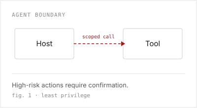

## 目录

- 背景
  - 行业现状
  - 案例：Conditional Access Optimization Agent
  - 两个案例对比
  - 风险地图
  - 攻击面
- 防御
  - 设计原则
  - 验证方法

---

# 1 背景

从标准、案例和攻击面三个角度，理解 agent 安全在 2026 年的变化。

---

## 1.1 行业现状

### 1.1.1 从模型安全到 agent 安全

- 标准组织开始发布 agent 专项风险清单。
- 攻击面从“模型”扩展到“工具链”。
- 安全团队开始把 agent 当作独立资产来管理。

> agent 安全已经不再只是模型安全的一个子集。

---

过去一年，变化主要体现在三件事上：

- 风险从“输出有害”转向“行为越权”。
- 防护从“提示词过滤”转向“权限与工具边界”。
- 评估从“单轮问答”转向“多步任务”。

---

## 1.2 案例：Conditional Access Optimization Agent

### 1.2.1 自治边界最清晰的样本

| 维度 | 观察 |
|---|---|
| 权限 | 只允许读写租户内的条件访问策略 |
| 边界 | 高风险动作必须人工确认 |
| 失败 | 越权请求会被策略层拒绝 |



> 这个案例的价值不在于能力，而在于边界。

---

## 1.3 两个案例对比

### 1.3.1 案例 A：边界清楚

- 工具集合固定。
- 每个工具都有明确权限。
- 高风险动作需要二次确认。

### 1.3.2 案例 B：边界模糊

- 工具可以动态扩展。
- 权限继承自用户会话。
- 缺少动作级审计。

> 两个案例的差异不在模型能力，而在工具边界。

---

## 1.4 风险地图

- 目标劫持：攻击者改变 agent 的任务目标。
- 工具滥用：agent 调用了不该调用的工具。
- 记忆投毒：长期记忆被写入恶意内容。

## 1.5 攻击面

- 输入面：文档、网页、邮件、搜索结果。
- 工具面：文件系统、浏览器、邮件、数据库。
- 身份面：token、cookie、服务账号。

---

# 2 防御

从设计原则到验证方法，给出一套可落地的最小防线。

---

<!-- scrollable -->
## 2.1 设计原则

### 2.1.1 最小权限

每个工具只拿到完成当前任务所需的最小权限。

```python
def allow(tool, scope):
    return tool in scope and scope[tool] == "current-task"
```

<details>
<summary>展开：为什么不是“默认允许”</summary>

默认允许会把一次提示注入放大成一次完整的工具链攻击。  
最小权限不能消除注入，但能把影响限制在当前任务内。

</details>

---

<!-- grid: 2 -->
## 2.2 验证方法


